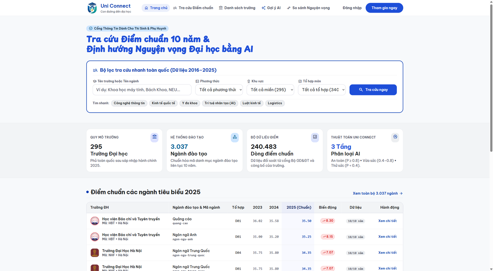
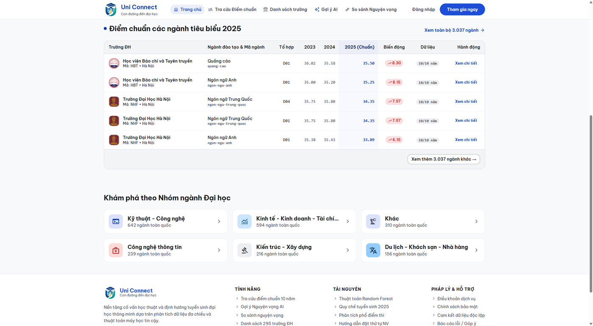
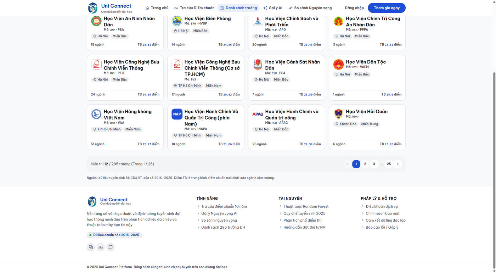

<div align="center">


# **Uni Connect**

### 🎓 *Tra cứu điểm chuẩn — Định hướng nguyện vọng bằng AI*

**Nhập điểm từng môn → nhận danh sách trường/ngành xếp theo xác suất đỗ.<br>Dựa trên dữ liệu 10 năm (2016–2025) · 295 trường · 3.037 ngành · 240.000+ bản ghi.**

<br>

[](https://www.djangoproject.com/)
[](https://www.python.org/)
[](https://www.mysql.com/)
[](docs/HUONG-DAN-CHI-TIET.md)
[](docs/HUONG-DAN-CHI-TIET.md)
[](docs/HUONG-DAN-CHI-TIET.md)

<br>

[🔍 Tính năng](#-tính-năng) · [🚀 Quick Start](#-quick-start) · [🏗️ Kiến trúc](#%EF%B8%8F-kiến-trúc) · [🔐 Bảo mật](#-bảo-mật--độ-bền) · [📚 Tài liệu](#-tài-liệu)

<br>



</div>

---

## ✨ Tính năng

<table>
<tr>
<td width="50%" valign="top">

### 🔍 Tra cứu điểm chuẩn

10 năm dữ liệu (2016–2025), lọc theo trường / ngành / tổ hợp / phương thức / tỉnh. API JSON kèm phân trang.

</td>
<td width="50%" valign="top">

### 🤖 Gợi ý nguyện vọng AI

Random Forest chấm **xác suất đỗ** trên 27 đặc trưng; mô hình lỗi thì fallback xếp hạng theo `margin`, không bao giờ 500.

</td>
</tr>
<tr>
<td width="50%" valign="top">

### 📊 Phân tầng 3 mức

🟢 **An toàn** · 🟡 **Vừa sức** · 🔴 **Thử sức** — kèm giải thích dựa trên đặc trưng thật của từng ngành.

</td>
<td width="50%" valign="top">

### 📝 Hồ sơ năng lực

Điểm từng môn, điểm học bạ, ưu tiên, nhóm ngành quan tâm — nhiều hồ sơ mỗi học sinh, lưu lịch sử gợi ý.

</td>
</tr>
<tr>
<td width="50%" valign="top">

### ⚖️ So sánh nguyện vọng

Đặt 2–3 nguyện vọng cạnh nhau trên cùng thang đo để cân nhắc trước khi chốt.

</td>
<td width="50%" valign="top">

### 🔐 OAuth + chống trùng Gmail

Google & Facebook. Chuẩn hoá alias Gmail (dấu chấm, `+tag`, `googlemail.com`) — **1 hộp thư = 1 tài khoản, mãi mãi.**

</td>
</tr>
<tr>
<td width="50%" valign="top">

### 🛡️ Rate limit toàn site

Đăng nhập, đăng ký, avatar, endpoint AI — cache chia sẻ giữa các process, chống giả mạo `X-Forwarded-For`.

</td>
<td width="50%" valign="top">

### 🧪 55 test tự động

Auth, OAuth, rate limit, migration email — chạy bằng SQLite in-memory, **không cần MySQL** để test.

</td>
</tr>
</table>

## 🚀 Quick Start

**Yêu cầu:** Python 3.10+ · MySQL 8.0+

```bash
# 1. Clone
git clone https://github.com/tann299/Uni-Map.git
cd Uni-Map
```

```bash
# 2. Virtual environment + dependencies (Windows PowerShell)
py -3.11 -m venv .venv
.\.venv\Scripts\Activate.ps1
pip install -r requirements.txt
```

```bash
# 3. Cấu hình môi trường
copy .env.example .env
# → điền DJANGO_SECRET_KEY và mật khẩu MySQL
```

```bash
# 4. Dựng database + nạp dữ liệu điểm chuẩn
mysql -u root -p --default-character-set=utf8mb4 < database/schema.sql
python database/import_mysql.py
```

```bash
# 5. Migration + chạy server
cd source
python manage.py migrate --fake-initial
python manage.py runserver
```

Mở **http://127.0.0.1:8000/** 🎉

```bash
# 6. Chạy test (SQLite in-memory — không cần MySQL)
python manage.py test
```

> Chi tiết từng bước + Linux/macOS + cấu hình OAuth → [docs/HUONG-DAN-CHI-TIET.md](docs/HUONG-DAN-CHI-TIET.md)

## 🏗️ Kiến trúc

```text
                    ┌───────────────────────────────┐
   👨‍🎓 Học sinh ────▶│      Django (source/)         │
                    │  accounts · university        │
                    │  admissions · recommendation  │
                    └───────────────┬───────────────┘
                                    │
          ┌─────────────────────────┼─────────────────────────┐
          ▼                         ▼                         ▼
 ┌─────────────────┐      ┌──────────────────┐      ┌──────────────────┐
 │ 📝 Hồ sơ năng   │      │ 🔍 CN-01 lọc     │      │ 🤖 Random Forest │
 │ lực: điểm từng  │─────▶│ tổ hợp khả dĩ   │─────▶│ predict_proba    │
 │ môn + ưu tiên   │      │ từ DB (SQL)      │      │ 27 đặc trưng     │
 └─────────────────┘      └──────────────────┘      └────────┬─────────┘
                                                             │
                                    ┌────────────────────────┴────────┐
                                    ▼                                 ▼
                        ┌──────────────────────┐        ┌──────────────────────┐
                        │ 🟢🟡🔴 P(đỗ) →      │        │ ⚠️ Model lỗi?        │
                        │ phân tầng 3 mức     │        │ fallback xếp theo    │
                        │ + giải thích        │        │ margin (dung_ai=0)   │
                        └──────────┬──────────┘        └──────────┬──────────┘
                                   └──────────────┬───────────────┘
                                                  ▼
                                    📚 LanGoiY + KetQuaGoiY (lịch sử)
```

Dữ liệu chảy một chiều: **crawler → CSV → MySQL → feature → model → tầng hiển thị.**

<details>
<summary>📸 Xem thêm giao diện</summary>

| | |
|:---:|:---:|
|  |  |
| *Kết quả gợi ý nguyện vọng* | *Chi tiết trường + điểm chuẩn* |
|  |  |
| *Tích hợp logo 295 trường* | *Trường ĐH Kiến trúc Đà Nẵng* |

</details>

## 🔐 Bảo mật & độ bền

- 🔑 **Mật khẩu** — Django hasher + validators; rate limit 5 lần sai/(IP+username)/5 phút
- 📧 **Email unique** — cột generated `NULLIF(LOWER(TRIM(email)), '')` + UNIQUE; email rỗng → NULL, không chặn user không email
- 🪪 **OAuth an toàn** — state chống CSRF một lần dùng; chỉ nhận `email_verified`; khoá cache chống race 2 callback song song
- 🛡️ **XFF spoof-proof** — chỉ tin `X-Forwarded-For` khi request đến từ proxy nội bộ; client ngoài không giả mạo được IP
- 🖼️ **Avatar 4 lớp** — đuôi file → dung lượng 5MB → pixel ≤4096 → verify nội dung thật bằng Pillow → resize WebP 300×300

## 📚 Tài liệu

| | Tài liệu | Nội dung |
|:---:|---|---|
| 📖 | [Hướng dẫn chi tiết](docs/HUONG-DAN-CHI-TIET.md) | Cài đặt đầy đủ, OAuth, deploy, migration email, rate limit |
| 📋 | [SRS](docs/SRS.md) | Đặc tả yêu cầu phần mềm (UC-01 → UC-10) |
| 🗃️ | [Mô hình dữ liệu](docs/README_DATA.md) | Schema, cửa sổ trượt, nguồn dữ liệu |
| 📝 | [Báo cáo đồ án](docs/Báo%20cáo/do-an.pdf) | Báo cáo LaTeX thành phẩm (PDF) |
| 🎓 | [Slide thuyết trình](docs/slide/Uni-Connect-slide-v3.pptx) | Slide bảo vệ đồ án |
| 🗺️ | [Sơ đồ CSDL](database/so_do_csdl.png) | ERD vẽ tự động từ schema.sql |

## 🗺️ Lộ trình

- [x] 🔍 Tra cứu điểm chuẩn 10 năm + cửa sổ trượt
- [x] 🔐 OAuth Google/Facebook + chống trùng Gmail mọi dạng alias
- [x] 🤖 Gợi ý AI + phân tầng + giải thích
- [x] 🛡️ Rate limit + cache chia sẻ + chống XFF spoof
- [x] 🧑‍💻 Console quản trị + pipeline cập nhật dữ liệu
- [ ] 📥 Dữ liệu đỗ/trượt thật để hiệu chỉnh calibration
- [ ] 🏫 Điểm học bạ theo từng tỉnh cho phương thức 2
- [ ] 🌐 Đa ngôn ngữ

---

<div align="center">

© 2025–2026 **Nguyễn Ngọc Tân** · `Tanngao333@gmail.com` · All rights reserved

Chi tiết kỹ thuật đầy đủ → **[docs/HUONG-DAN-CHI-TIET.md](docs/HUONG-DAN-CHI-TIET.md)**

⭐ Nếu dự án hữu ích, đặt một **star** cho repo!

</div>
