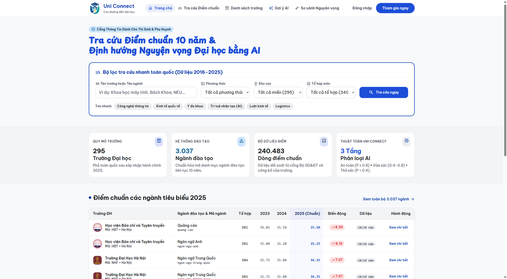
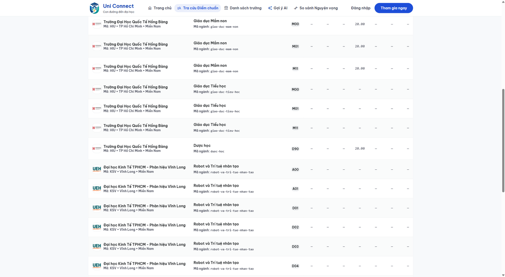
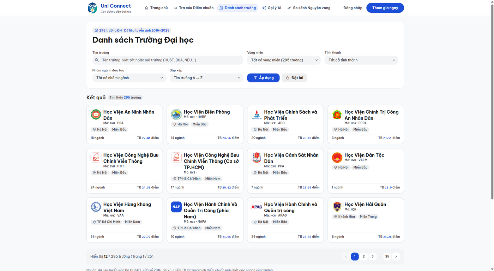
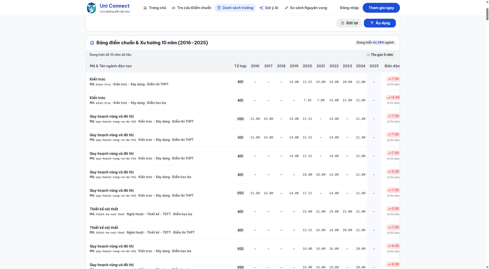
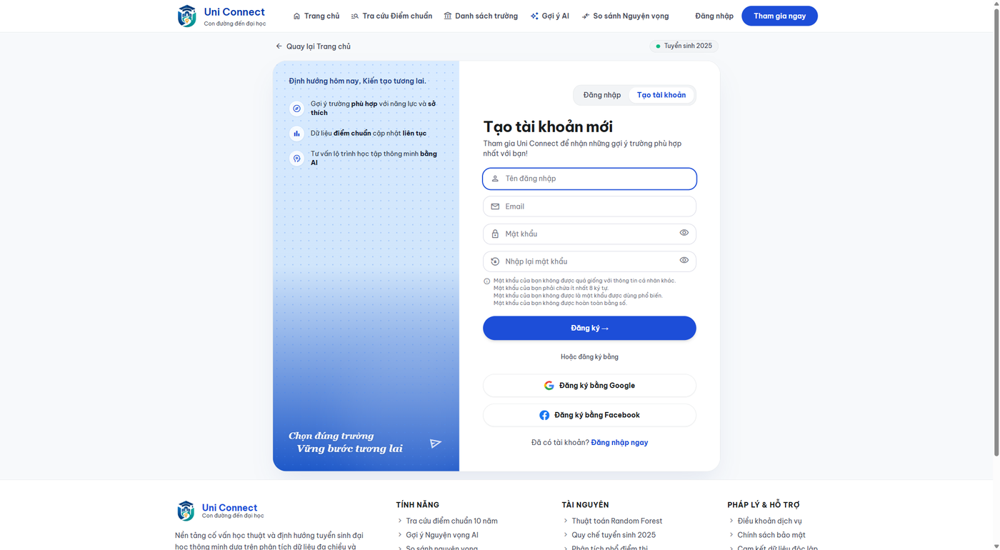
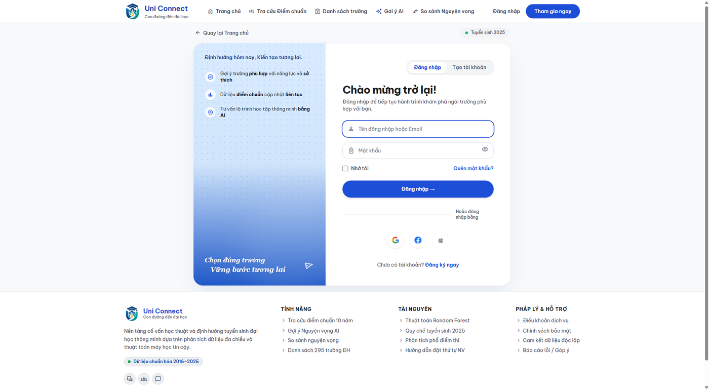

# Uni Connect

**Uni Connect** là nền tảng tra cứu tuyển sinh và định hướng nguyện vọng đại học cho học sinh THPT. Người dùng nhập điểm theo môn, xem điểm chuẩn nhiều năm, lưu hồ sơ năng lực và nhận danh sách trường/ngành được xếp hạng theo mức độ phù hợp.

> Dự án thuộc sở hữu của **Nguyễn Ngọc Tân** — `Tanngao333@gmail.com`.
>
> Repository chưa công bố license. Không tự ý sử dụng lại mã nguồn, dữ liệu hoặc tài sản thiết kế cho mục đích khác khi chưa có sự đồng ý của chủ sở hữu.



## Tính năng

- Tra cứu điểm chuẩn theo trường, ngành, tổ hợp, phương thức, tỉnh/thành và năm.
- Xem danh sách trường, logo, thông tin chi tiết và xu hướng điểm chuẩn.
- Đăng ký/đăng nhập bằng tài khoản thường.
- Đăng nhập nhanh bằng Google OAuth 2.0 và Facebook OAuth 2.0.
- Chuẩn hóa alias Gmail: dấu chấm, `+tag`, chữ hoa/thường và `googlemail.com` được nhận diện là cùng hộp thư.
- Một email đã tồn tại luôn đăng nhập vào tài khoản cũ; không tạo record mới.
- Hồ sơ năng lực: điểm từng môn, phương thức xét tuyển, ưu tiên và nhóm ngành quan tâm.
- Gợi ý nguyện vọng bằng Random Forest, có chế độ dự phòng theo `margin` khi mô hình không khả dụng.
- Phân tầng kết quả: **An toàn / Vừa sức / Thử sức**.
- So sánh nguyện vọng và lưu lịch sử gợi ý.
- Avatar: kiểm tra định dạng, dung lượng, kích thước pixel, xác thực nội dung ảnh bằng Pillow và resize WebP.
- Rate limit đăng nhập, đăng ký, upload avatar và endpoint gợi ý AI.
- Giao diện responsive bằng Django Templates + Tailwind CSS CDN.

## Ảnh giao diện

| Trang chủ | Tra cứu |
|---|---|
|  |  |

| Danh sách trường | Chi tiết trường |
|---|---|
|  |  |

| Đăng ký | Đăng nhập |
|---|---|
|  |  |

## Công nghệ

- Python 3.10+
- Django 5.2
- MySQL 8.0+
- Pandas, NumPy, scikit-learn
- Pillow
- HTML/CSS/JavaScript, Django Templates, Tailwind CSS CDN
- Google/Facebook OAuth 2.0

## Cấu trúc repository

```text
Uni-Map/
├── source/                    Django project
│   ├── config/                settings, URL root, WSGI/ASGI
│   ├── accounts/              auth thường, OAuth, profile, rate limit
│   ├── admissions/            hồ sơ năng lực và điểm môn
│   ├── university/            tra cứu, trường, ngành, API
│   ├── recommendation/        gợi ý AI, so sánh, lịch sử
│   ├── quantri/               console quản trị
│   ├── templates/              base template dùng chung
│   └── manage.py
├── database/
│   ├── schema.sql             schema MySQL nguồn sự thật
│   ├── import_mysql.py        import dữ liệu CSV vào MySQL
│   └── ve_so_do.py             sinh ERD
├── datas/                    crawler và dữ liệu nguồn
├── docs/                     SRS, dữ liệu và slide báo cáo
├── requirements.txt
└── README.md
```

## Clone và cài đặt local

### 1. Clone

```bash
git clone https://github.com/tann299/Uni-Map.git
cd Uni-Map
```

### 2. Tạo virtual environment

Windows PowerShell:

```powershell
py -3.11 -m venv .venv
.\.venv\Scripts\Activate.ps1
python -m pip install --upgrade pip
pip install -r requirements.txt
```

Linux/macOS:

```bash
python3.11 -m venv .venv
source .venv/bin/activate
python -m pip install --upgrade pip
pip install -r requirements.txt
```

### 3. Tạo file `.env`

`.env` không được commit. Tạo file tại thư mục gốc:

```dotenv
DJANGO_SECRET_KEY=thay-bang-chuoi-bi-mat
DJANGO_DEBUG=1
DJANGO_ALLOWED_HOSTS=127.0.0.1,localhost

DB_NAME=uni_map
DB_USER=root
DB_PASSWORD=
DB_HOST=127.0.0.1
DB_PORT=3306

# OAuth — để trống nếu chỉ dùng đăng nhập thường
GOOGLE_CLIENT_ID=
GOOGLE_CLIENT_SECRET=
FACEBOOK_APP_ID=
FACEBOOK_APP_SECRET=
```

Django đọc biến môi trường từ `.env` bằng loader tích hợp trong `source/config/settings.py`.

### 4. Dựng MySQL

Tạo database UTF-8 rồi chạy schema:

```bash
mysql -u root -p --default-character-set=utf8mb4 < database/schema.sql
```

Sau đó import dữ liệu tuyển sinh nếu đã có CSV:

```bash
python database/import_mysql.py
```

`database/schema.sql` là nguồn sự thật cho các bảng dữ liệu nghiệp vụ. Các model dữ liệu crawl dùng `managed = False`, nên Django không tự tạo/xóa các bảng đó.

### 5. Migration Django và chạy app

```bash
cd source
python manage.py migrate --fake-initial
python manage.py check
python manage.py runserver
```

Mở <http://127.0.0.1:8000/>.

> Migration `accounts.0002_email_unique_don_trung` chuẩn hóa dữ liệu user cũ, gộp/xóa user trùng email và tạo cơ chế unique email an toàn với email rỗng. Trên hosting, đọc hướng dẫn triển khai bên dưới trước khi chạy migration.

## Kiểm thử

Chạy toàn bộ test với SQLite in-memory để không cần MySQL local:

```bash
cd source
$env:DJANGO_SETTINGS_MODULE="config.test_sqlite"
python manage.py test
```

Hoặc Linux/macOS:

```bash
DJANGO_SETTINGS_MODULE=config.test_sqlite python manage.py test
```

Các test bao phủ:

- đăng ký trùng username và email;
- alias Gmail và login lặp lại;
- dữ liệu email cũ chưa chuẩn hóa;
- admin add/change user;
- rate limit và chống giả mạo `X-Forwarded-For`;
- migration email unique;
- OAuth Google/Facebook.

Kiểm tra route media trên môi trường `DEBUG=0`:

```bash
cd source
python kiemtra_media.py
```

## OAuth redirect URI

Google Cloud Console cần khai báo đúng từng URI:

Local:

```text
http://localhost:8000/accounts/google/xac-thuc/
```

Production:

```text
https://uniconnect.id.vn/accounts/google/xac-thuc/
```

Facebook dùng:

```text
https://uniconnect.id.vn/accounts/facebook/xac-thuc/
```

Không thêm khoảng trắng, không bỏ dấu `/` cuối và không dùng `http` cho production.

## Deploy hosting thủ công

Repository không yêu cầu host liên kết Git. Khi upload bằng File Manager/FTP:

1. Backup database và `source/media/` trước.
2. Upload code trong `source/`, không ghi đè `.env` và `source/media/`.
3. Đảm bảo `source/.cache/` tồn tại và writable — rate limit dùng `FileBasedCache` để chia sẻ giữa các process.
4. Chạy migration `accounts.0002` khi host có Python tương thích Django.
5. Nếu áp schema bằng phpMyAdmin, dùng cột generated để email rỗng vẫn hợp lệ:

```sql
ALTER TABLE auth_user
  ADD COLUMN email_duy_nhat VARCHAR(254)
    GENERATED ALWAYS AS (NULLIF(LOWER(TRIM(email)), '')) STORED,
  ADD UNIQUE KEY uq_auth_user_email_chuan (email_duy_nhat);
```

6. Chạy `collectstatic --noinput`.
7. Restart Python/Passenger application.
8. Kiểm tra `/`, `/accounts/dang-ky/`, `/accounts/dang-nhap/`, `/tra-cuu/` và login Google lặp lại.

Không commit `.env`, password, OAuth secret, database dump, `media/`, `staticfiles/`, cache hoặc `node_modules/`.

## Dữ liệu và mô hình AI

- Dữ liệu điểm chuẩn nằm trong `datas/data/` sau khi crawler chạy.
- `train_dataset.csv` và `test_dataset.csv` là artifact sinh lại được, không cần đưa lên production.
- Production chỉ cần artifact model (`model.pkl`, `scaler.pkl`, metadata cần thiết).
- Crawl/import có transaction và self-check; nếu self-check fail thì dừng trước khi ghi dữ liệu.

## Tài liệu

- [Đặc tả yêu cầu — SRS](docs/SRS.md)
- [Mô hình dữ liệu](docs/README_DATA.md)
- [Slide báo cáo](docs/slide/Uni-Connect-slide-v3.pptx)

## Chủ sở hữu

**Nguyễn Ngọc Tân**
Email: `Tanngao333@gmail.com`

© 2025–2026 Uni Connect. All rights reserved. License chưa được công bố.
