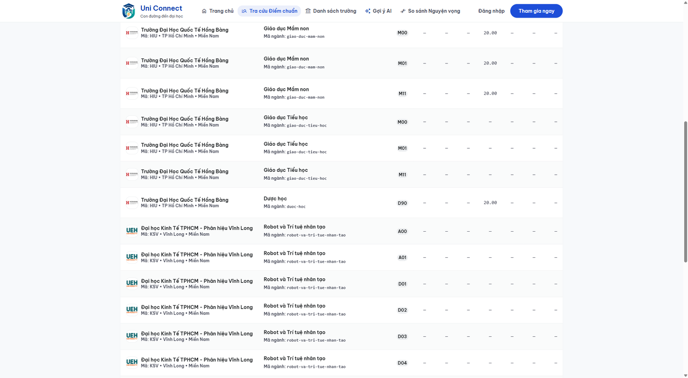
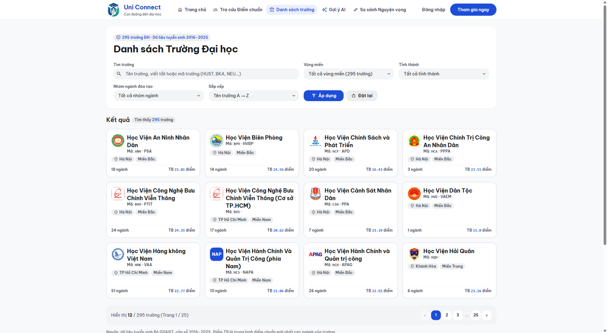
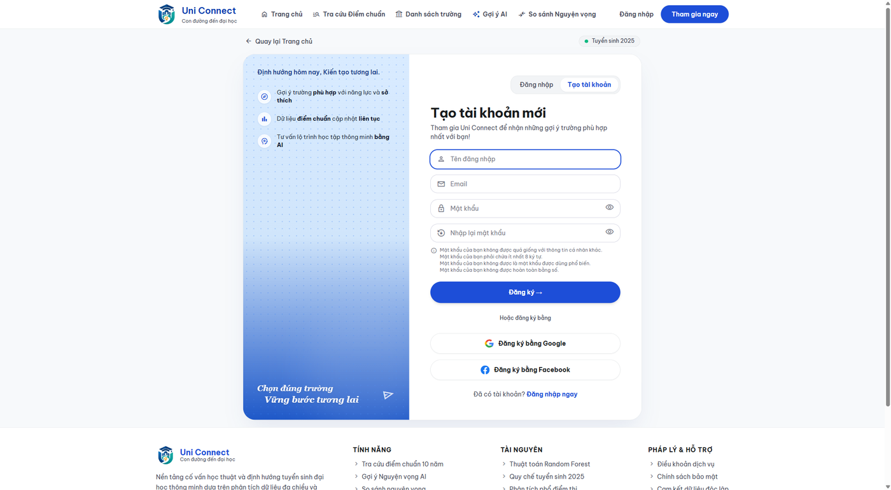

<div align="center">


# Uni Connect

**Tra cứu điểm chuẩn 10 năm · Gợi ý nguyện vọng AI · Sẵn sàng cho shared hosting**

[](https://www.djangoproject.com/)
[](https://www.python.org/)
[](https://www.mysql.com/)
[](docs/HUONG-DAN-CHI-TIET.md#mô-hình-ai)
[](docs/HUONG-DAN-CHI-TIET.md#deploy-hosting-thủ-công)

[Giới thiệu](#-tính-năng) · [Quick Start](#-quick-start) · [Kiến trúc](#%EF%B8%8F-kiến-trúc) · [Hướng dẫn chi tiết](docs/HUONG-DAN-CHI-TIET.md)

</div>

---

## 🎯 Uni Connect là gì?

Nền tảng tra cứu tuyển sinh và định hướng nguyện vọng đại học cho học sinh THPT: nhập điểm từng môn → nhận danh sách trường/ngành xếp theo **xác suất đỗ** do mô hình Random Forest chấm, chia ba tầng **An toàn / Vừa sức / Thử sức**, dựa trên dữ liệu điểm chuẩn 10 năm (2016–2025) của 295 trường đại học.

| | |
|:---:|:---:|
|  |  |
| *Trang chủ* | *Tra cứu điểm chuẩn* |
|  |  |
| *Danh sách 295 trường* | *Đăng ký tài khoản* |

## ✨ Tính năng

| | Tính năng | Mô tả |
|:---:|---|---|
| 🔍 | **Tra cứu điểm chuẩn 10 năm** | Lọc theo trường, ngành, tổ hợp, phương thức, tỉnh, năm — API JSON kèm phân trang |
| 🤖 | **Gợi ý nguyện vọng AI** | Random Forest chấm xác suất đỗ trên 27 đặc trưng; fallback xếp hạng theo `margin` khi mô hình lỗi |
| 📊 | **Phân tầng 3 mức** | An toàn / Vừa sức / Thử sức + lời giải thích dựa trên đặc trưng thật |
| 📝 | **Hồ sơ năng lực** | Điểm từng môn, điểm học bạ, ưu tiên, nhóm ngành quan tâm — nhiều hồ sơ mỗi học sinh |
| ⚖️ | **So sánh nguyện vọng** | Chọn 2–3 nguyện vọng cạnh nhau, cùng thang đo với trang gợi ý |
| 🔐 | **Đăng nhập OAuth** | Google + Facebook; chuẩn hoá alias Gmail (dấu chấm, `+tag`, `googlemail.com`) — 1 hộp thư = 1 tài khoản, mãi mãi |
| 🛡️ | **Rate limit toàn site** | Đăng nhập, đăng ký, upload avatar, endpoint AI — cache chia sẻ giữa các process, chống giả mạo `X-Forwarded-For` |
| 🧪 | **55 test tự động** | Auth, OAuth, rate limit, migration email — chạy bằng SQLite, không cần MySQL |

## 🚀 Quick Start

```bash
git clone https://github.com/tann299/Uni-Map.git
cd Uni-Map
```

```bash
py -3.11 -m venv .venv && .\.venv\Scripts\Activate.ps1
pip install -r requirements.txt
```

```bash
copy .env.example .env
# → điền DJANGO_SECRET_KEY và mật khẩu MySQL
```

```bash
mysql -u root -p --default-character-set=utf8mb4 < database/schema.sql
```

```bash
python database/import_mysql.py
cd source && python manage.py migrate --fake-initial && python manage.py runserver
```

Mở **http://127.0.0.1:8000/** — chi tiết từng bước trong [docs/HUONG-DAN-CHI-TIET.md](docs/HUONG-DAN-CHI-TIET.md).

```bash
cd source && python manage.py test   # 55 tests, SQLite in-memory
```

## 🏗️ Kiến trúc

```text
                        ┌─────────────────────────┐
        Học sinh ──────▶│   Django (source/)      │
                        │  accounts  university   │
                        │  admissions    quantri  │
                        └───────────┬─────────────┘
                                    │
              ┌─────────────────────┼──────────────────────┐
              ▼                     ▼                      ▼
     ┌────────────────┐   ┌────────────────┐    ┌────────────────┐
     │ HoSoNangLuc    │   │ CN-01 lọc      │    │ RandomForest   │
     │ điểm từng môn  │──▶│ tổ hợp từ DB   │──▶ │ predict_proba  │
     │ + ưu tiên      │   │ (SQL + index)  │    │ 27 features    │
     └────────────────┘   └────────────────┘    └───────┬────────┘
                                                        │
                                          ┌─────────────┴─────────────┐
                                          ▼                           ▼
                                 ┌────────────────┐         ┌────────────────┐
                                 │ P(đỗ) → phân   │         │ model lỗi?     │
                                 │ tầng 3 mức     │         │ fallback margin│
                                 └───────┬────────┘         └───────┬────────┘
                                         └──────────┬───────────────┘
                                                    ▼
                                        LanGoiY + KetQuaGoiY (lịch sử)
```

Dữ liệu chảy một chiều: crawler → CSV → MySQL → feature → model → tầng hiển thị.

## 🔐 Bảo mật & độ bền

- 🔑 **Mật khẩu** — Django hasher, validators mặc định; rate limit 5 lần sai/(IP+username)/5 phút
- 📧 **Email unique** — cột generated `NULLIF(LOWER(TRIM(email)), '')` + UNIQUE, email rỗng → NULL không chặn
- 🪪 **OAuth an toàn** — state chống CSRF một lần dùng, chỉ nhận `email_verified`, khoá cache chống race 2 callback song song
- 🛡️ **XFF spoof-proof** — chỉ tin `X-Forwarded-For` khi request đến từ proxy nội bộ; client ngoài không giả mạo được IP
- 🖼️ **Avatar 4 lớp** — đuôi file → dung lượng 5MB → pixel 4096 → verify nội dung bằng Pillow → resize WebP 300×300

## 📚 Tài liệu

| Tài liệu | Nội dung |
|---|---|
| [Hướng dẫn chi tiết](docs/HUONG-DAN-CHI-TIET.md) | Cài đặt đầy đủ, OAuth, deploy, migration email, rate limit |
| [SRS](docs/SRS.md) | Đặc tả yêu cầu phần mềm (UC-01 → UC-10) |
| [Mô hình dữ liệu](docs/README_DATA.md) | Schema, cửa sổ trượt, nguồn dữ liệu |
| [Sơ đồ CSDL](database/so_do_csdl.png) | ERD vẽ tự động từ schema.sql |

## 🗺️ Lộ trình

- [x] Tra cứu điểm chuẩn 10 năm + cửa sổ trượt
- [x] OAuth Google/Facebook + chống trùng Gmail mọi dạng alias
- [x] Gợi ý AI + phân tầng + giải thích
- [x] Rate limit + cache chia sẻ + chống XFF spoof
- [x] Console quản trị + pipeline cập nhật dữ liệu
- [ ] Dữ liệu đỗ/trượt thật để hiệu chỉnh calibration
- [ ] Điểm học bạ theo từng tỉnh cho phương thức 2
- [ ] Đa ngôn ngữ

---

<div align="center">

© 2025–2026 **Nguyễn Ngọc Tân** · `Tanngao333@gmail.com` · All rights reserved

Chi tiết kỹ thuật đầy đủ → [docs/HUONG-DAN-CHI-TIET.md](docs/HUONG-DAN-CHI-TIET.md)

</div>
